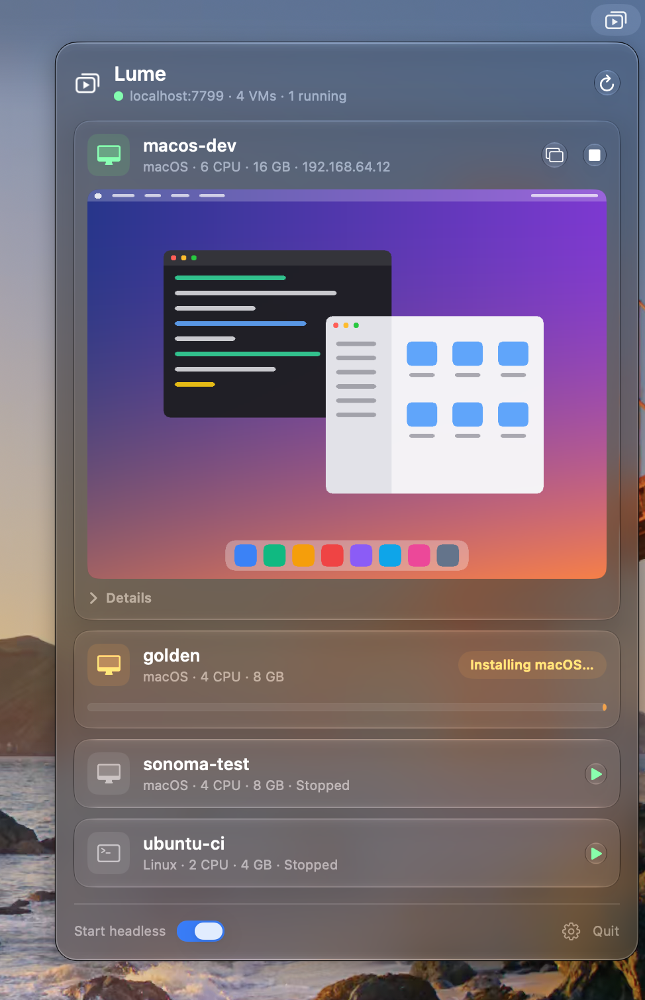

<p align="center">
  
</p>

<h1 align="center">LumeBar</h1>

<p align="center">
  Your <a href="https://cua.ai/docs/lume">Lume</a> virtual machines, one click away in the macOS menu bar.
</p>

<p align="center">
  
</p>

Release candidate: `1.0.0-beta4` (build 104)

## Features
- **See everything at a glance:** every VM with its OS, CPU, memory and IP, running VMs on top, plus a live service status in the header
- **Start and stop in one click** on the configured Lume service, headless or with a display
- **Screen previews:** a single read-only VNC snapshot for eligible running VMs in the menu. Double-click it to open Screen Sharing.
- **Lume VNC or macOS Screen Sharing:** pick a source for each VM from its actions menu.
- **Provisioning progress:** VMs that are still installing show what they're doing instead of a Start button
- **VM actions:** use the ellipsis or right-click a row to choose a start mode, manage Screen Sharing, or copy the VM name or IP.
- **Details on demand:** disk, storage, display and creation date behind a single disclosure

## Requirements
- macOS 26+
- Swift 6.2 (SwiftPM) with full Xcode installed (Command Line Tools alone can't compile the asset catalog)
- Lume 0.6.0 or later for VNC-disabled starts. The default is `http://localhost:7777`.
- The local `lume` CLI is optional. LumeBar can use it to start the default local service if needed.
- Lume docs: https://cua.ai/docs/lume

## Getting Started
1. Ensure the Lume service is running locally. The app will attempt to start it by running `lume serve` if it cannot connect.
2. Build the app:

```bash
swift build -c release
```

3. Run the app:

```bash
swift run LumeBar
```

## Package as a `.app`
Create a local app bundle and zip archive:

```bash
scripts/package-app.sh
```

Artifacts:
- `dist/LumeBar.app`
- `dist/LumeBar.zip`

For signed distribution (Developer ID + notarization):

```bash
scripts/sign-and-notarize.sh \
  --identity "Developer ID Application: Your Name (TEAMID)" \
  --keychain-profile "<notarytool-profile>"
```

## Configuration
- **Service URL:** enter the HTTP or HTTPS address in Settings, then select **Save and Test**. The selected service owns VM actions and display launches. For a remote service, **With display** starts the display on the Lume host. Use **Screen Sharing** to connect from this Mac.
- **Start VMs:** choose headless without Lume VNC, headless with Lume VNC, or with display. The default is headless without Lume VNC.
- **Local Lume CLI:** Settings shows the binary available for starting the default local service.

## App icon
The app icon and menu bar symbol are drawn as SVG in `design/icon/`. After editing them, regenerate the asset catalog PNGs:

```bash
swift scripts/render-icons.swift
```

## Screen Sharing sources
Right-click a running VM and pick **Screen Sharing Source**:
- **Automatic** (default): prefer macOS Screen Sharing for a guest with a saved login. Otherwise use an advertised Lume VNC endpoint, or the guest IP if there is no Lume VNC endpoint. For Linux guests, Automatic uses Lume VNC.
- **Lume VNC**: only Lume's built-in VNC server.
- **macOS Screen Sharing**: only the guest's own Screen Sharing. Enable it in the guest (System Settings › General › Sharing). If the guest uses Remote Management, grant the login **Observe** access.

For a live preview of a guest's Screen Sharing, use **Screen Sharing Login…**. LumeBar stores the login in Keychain for the selected service, VM, storage location, and guest address. If the guest address changes, enter the login again. Saved logins from builds that keyed entries only by VM name require re-entry. The Screen Sharing button can open the guest before you save a login.

## Troubleshooting
- Connecting to a guest needs macOS **Local Network** permission. macOS asks the first time; if previews show `Network is down` (NWError 50), enable LumeBar in System Settings › Privacy & Security › Local Network. After updating to a build with a different signature, switch it off and on again. Builds signed with a stable Developer ID keep the permission.
- If the local service is unavailable, run `lume serve` on the Lume host or check that the local CLI is installed. Settings shows the binary LumeBar found.
- To retry a preview after an error or early boot, reopen the menu. Use **Screen Sharing Source** to select Lume VNC if the guest has an IP address but guest Screen Sharing is off.

## Third-Party Notices
See `THIRD_PARTY_NOTICES.md`.

## License
MIT. See `LICENSE`.
